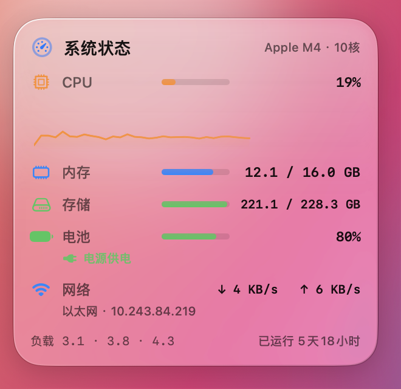
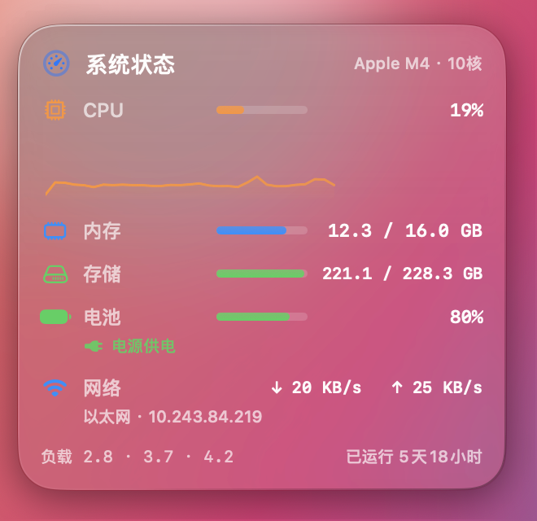
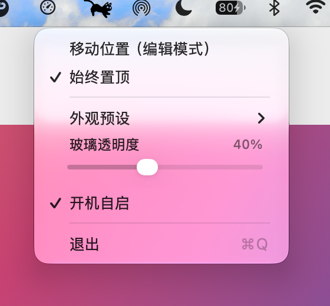

<p align="center">
  <a href="README.md">English</a> · <a href="README.zh-CN.md">简体中文</a>
</p>

# SystemWidget — macOS System Status Widget

A real-time macOS desktop widget that shows CPU, memory, disk, battery, and network stats on your desktop, refreshed every second.


<p align="center">
  
  
  <br><sub>v2.1.0 screenshots</sub>
</p>

## Liquid Glass

On macOS 26 and later, AppKit renders the card using its native `NSGlassEffectView`. The glass samples what is behind the window, including the wallpaper or apps underneath when the widget is floating. Its appearance also follows macOS Liquid Glass and accessibility settings. macOS 15 uses a frosted backdrop.

- Use **Glass transparency** in the menu bar to adjust tint live. At 0%, the card is nearly solid. At 100%, it uses the system glass without additional tint. The value is saved.
- Use **Appearance presets** to follow the system or select dark or light glass.

<p align="center">
  
</p>

## Download

Prebuilt releases are available on the [Releases](https://github.com/zoryabc/macos-system-status-widget/releases) page — no build required. Download the `.dmg`, double-click to open it, then drag `SystemWidget.app` into the Applications folder. A `.zip` version is also available.

> Why not use the built-in WidgetKit?
>
> WidgetKit widgets cannot refresh frequently (usually only once every dozen or so minutes), which makes them unsuitable for real-time monitoring. This project uses a borderless floating window instead, so it can show real data refreshed every second.

## Features

- Real-time CPU, memory, disk, and battery status, refreshed every second
- CPU usage history for the last 45 seconds (Activity Monitor style)
- Load averages (1/5/15 minutes) and system uptime
- Battery remaining time estimate and charge/discharge power (discharge/charge state auto-detected)
- Real-time network throughput (up/down), network name, and local IP
- Liquid Glass card that follows the system appearance, or lock it to dark / light glass; selection remembered
- Glass transparency slider, stepless 0–100%, live preview, remembered across launches
- Capsule meters with smooth value transitions (no longer the stock progress bar)
- "Launch at Login" toggle, starts automatically at login
- Click-through, so it never blocks desktop interaction; position remembered automatically
- Fully local app, no network requests, all data comes from your machine

## Requirements

- macOS 15.0 or later (Liquid Glass on macOS 26 and later; older systems fall back to a frosted material)
- Apple Silicon (M-series) or Intel Mac. Release builds include both architectures.
- Building requires Xcode 26 or later (the Liquid Glass SDK; the app still runs on macOS 15)

## Quick Start

```bash
git clone https://github.com/zoryabc/macos-system-status-widget.git
cd macos-system-status-widget
./build.sh
open build/SystemWidget.app
```

Or install it directly into your personal Applications folder and enable launch at login:

```bash
./install.sh
```

## Usage

1. After launch, the widget appears in the top-right corner of the desktop by default.
2. Click the dashboard icon in the menu bar:
   - **Move (edit mode)**: drag anywhere on the card, including across displays. Select the menu item again to lock it.
   - **Always on Top**: keep the card above all windows.
   - **Appearance presets**: follow the system, or lock to dark / light glass; the selection is remembered.
   - **Glass transparency**: drag the slider — 0% most solid, 100% most transparent; the card follows live and the value is saved.
   - **Launch at Login**: when checked, starts automatically at login; uncheck to unregister.
   - **Quit**: exit the widget.
3. While locked, the card is click-through, so it doesn't interfere with desktop interaction; its position is remembered automatically.

## Building from Source

```bash
./build.sh
```

Build output:

- `build/SystemWidget.app` — the widget itself
- `build/statscli` — a command-line tool that prints a system status snapshot for verification:

```bash
./build/statscli
# CPU:      12%  (10 cores, Apple M4)
# Memory:   72% used  (11.6 / 16.0 GB)
# Disk:     90% used  (205.1 / 228.3 GB)
# Battery:  54% (battery)
```

> Note: the app is ad-hoc signed (`codesign -`) for personal local use only and is not distributed through the App Store.

## Project Structure

```text
.
├── Sources/
│   ├── AppEntry.swift   # SwiftUI gauges, menu bar, application state
│   ├── WidgetPanel.swift # AppKit window, native glass, dragging, and position restoration
│   ├── Stats.swift      # Background system metrics sampler
│   └── main.swift       # CLI verification tool entry point
├── Info.plist
├── build.sh             # Build script
├── install.sh           # Installs to ~/Applications and registers launch at login
└── .github/workflows/   # GitHub Actions builds
```

## Data Sources

| Metric | Source |
| ---- | ---- |
| CPU | Mach `host_processor_info` (total + per-core) |
| Memory | `host_statistics64` (active + wired + compressed) |
| Disk | root volume filesystem attributes |
| Battery | IOKit power management (remaining time, charge/discharge power) |
| Network | `getifaddrs` traffic counters (rate) + SystemConfiguration primary interface + CoreWLAN SSID |
| Load / uptime | `getloadavg` / `kern.boottime` |

## FAQ

- **Widget not showing**: toggle "Always on Top" once in the menu bar to force it to the front.
- **How to update after rebuilding**: run `./install.sh`; it replaces the app and restarts it automatically.
- **How to disable launch at login**: uncheck "Launch at Login" in the menu bar, or delete
  `~/Library/LaunchAgents/local.systemwidget.plist`.
- **Want to adjust opacity or appearance**: switch presets and drag the transparency slider in the menu bar;
  the tint range at either end is set by `WidgetSurface.updateTint()` in `Sources/WidgetPanel.swift`;
  for the card radius, edit `WidgetMetrics.cardRadius`.

## License

[MIT](LICENSE)
