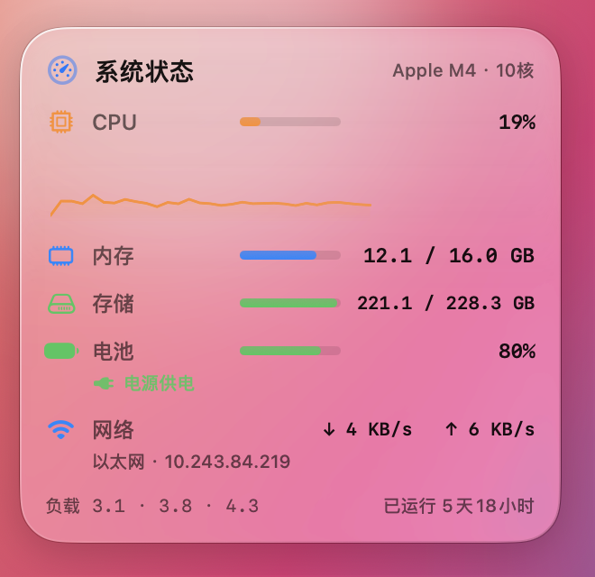
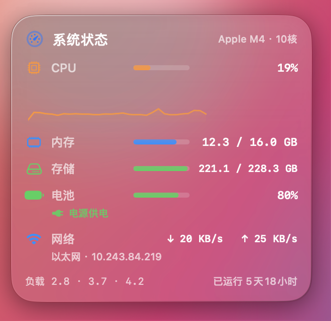
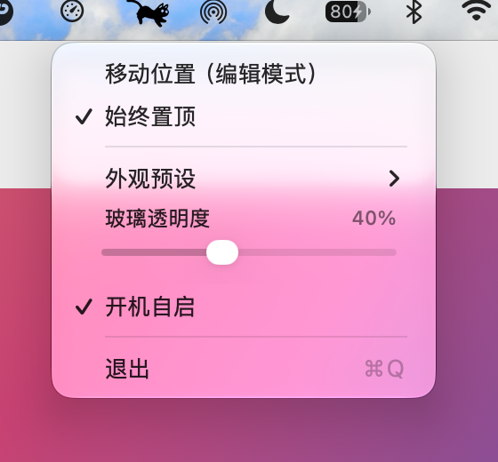

<p align="center">
  <a href="README.md">English</a> · <a href="README.zh-CN.md">简体中文</a>
</p>

# macOS 系统状态小组件（SystemWidget）

一款运行在 macOS 桌面上的实时系统监控小组件：CPU、内存、存储、电池，每秒刷新，一目了然。


<p align="center">
  
  
  <br><sub>v2.1.0 界面截图</sub>
</p>

## 液态玻璃外观

macOS 26 及以上使用 AppKit 原生 `NSGlassEffectView` 绘制卡片。玻璃会随窗口后方的画面变化，包括桌面壁纸和置顶时下方的应用。实际观感也随 macOS 的液态玻璃和辅助功能设置变化。macOS 15 使用磨砂材质。

- 在菜单栏的**玻璃材质**中可选择**通透玻璃**（默认）或**标准玻璃**。通透玻璃将原生玻璃与直接透出的背景混合，保留更多壁纸细节，数据文字仍保持清晰。标准玻璃使用完整的系统玻璃效果。材质选择会自动保存。
- **玻璃透明度**滑块即时生效。通透玻璃随滑块调节背景透出比例和染色，标准玻璃随滑块调节染色。设置会自动保存。
- 在**外观预设**中可跟随系统，或选择深色、浅色玻璃。

<p align="center">
  
</p>

## 下载

可以在 [Releases](https://github.com/zoryabc/macos-system-status-widget/releases) 页面下载打包好的版本，无需本地构建：下载 `.dmg` 后双击打开，把 `SystemWidget.app` 拖入 Applications 文件夹即可完成安装；也提供 `.zip` 版本。

> 为什么不用系统自带的 WidgetKit？
>
> WidgetKit 小组件无法高频刷新（通常十几分钟才更新一次），不适合实时监控。
> 本项目改用无边框浮动窗口实现，才能做到每秒刷新真实数据。

## 功能特性

- 实时显示 CPU、内存、存储、电池状态，每秒刷新
- CPU 最近 45 秒使用曲线（Activity Monitor 风格）
- 负载均值（1/5/15 分钟）与系统运行时间
- 电池剩余时间估算与充放电功率显示（放电/充电状态自动识别）
- 实时网络速率（上下行）、网络名称与本机 IP
- 液态玻璃卡片，跟随系统深浅色；也可手动锁定深色 / 浅色玻璃，选择自动记忆
- 玻璃透明度滑块，0–100% 无级调节，拖动即时生效并自动记忆
- 胶囊仪表条，数值变化平滑过渡（不再是系统默认进度条）
- 「开机自启」开关，登录时自动启动
- 点击穿透，不挡桌面操作；位置自动记忆
- 纯本地应用，无任何网络请求，数据全部来自本机

## 环境要求

- macOS 15.0 或更高版本（macOS 26 起启用液态玻璃，更早系统自动退回毛玻璃）
- 支持 Apple Silicon（M 系列）和 Intel Mac，发布包同时包含两种架构
- 构建需要 Xcode 26 或更高版本（用到 Liquid Glass 的 SDK；运行时仍兼容 macOS 15）

## 快速开始

```bash
git clone https://github.com/zoryabc/macos-system-status-widget.git
cd macos-system-status-widget
./build.sh
open build/SystemWidget.app
```

也可以直接安装到个人 Applications 文件夹并启用开机自启：

```bash
./install.sh
```

## 使用说明

1. 启动后，小组件默认出现在桌面右上角。
2. 点击菜单栏的仪表盘图标：
   - **移动位置（编辑模式）**：按住卡片任意位置即可拖动，支持跨屏。再次选择该菜单项恢复锁定。
   - **始终置顶**：让卡片浮在所有窗口之上。
   - **外观预设**：跟随系统 / 深色玻璃 / 浅色玻璃，选择自动记忆。
   - **玻璃材质**：切换通透玻璃和标准玻璃（macOS 26 及以上）。
   - **玻璃透明度**：拖动滑块即可，0% 最实、100% 最透，边拖边看效果，松手后自动保存。
   - **开机自启**：勾选后登录时自动启动，取消即移除注册。
   - **退出**：退出小组件。
3. 锁定状态下点击穿透卡片，不影响桌面操作；位置会自动记住。

## 从源码构建

```bash
./build.sh
```

构建产物：

- `build/SystemWidget.app` — 小组件本体
- `build/statscli` — 命令行工具，打印一次系统状态用于验证：

```bash
./build/statscli
# CPU:      12%  (10 cores, Apple M4)
# Memory:   72% used  (11.6 / 16.0 GB)
# Disk:     90% used  (205.1 / 228.3 GB)
# Battery:  54% (battery)
```

> 说明：应用使用 ad-hoc 签名（`codesign -`），仅用于本机个人使用，不面向 App Store 分发。

## 项目结构

```text
.
├── Sources/
│   ├── AppEntry.swift   # SwiftUI 仪表、菜单栏和应用状态
│   ├── WidgetPanel.swift # AppKit 窗口、原生玻璃、拖动和位置恢复
│   ├── Stats.swift      # 后台系统指标采集
│   └── main.swift       # 命令行验证工具入口
├── Info.plist
├── build.sh             # 构建脚本
├── install.sh           # 安装到 ~/Applications 并注册开机自启
└── .github/workflows/   # GitHub Actions 构建
```

## 数据来源

| 指标 | 来源 |
| ---- | ---- |
| CPU | Mach `host_processor_info`（总占用 + 每核心） |
| 内存 | `host_statistics64`（active + wired + compressed） |
| 存储 | 根卷文件系统属性 |
| 电池 | IOKit 电源管理（含剩余时间、充放电功率） |
| 网络 | `getifaddrs` 流量计数器（速率）+ SystemConfiguration 主接口 + CoreWLAN SSID |
| 负载 / 运行时间 | `getloadavg` / `kern.boottime` |

## 常见问题

- **卡片不显示**：在菜单栏把「始终置顶」开关一次，强制置前。
- **重新构建后如何更新**：运行 `./install.sh` 会自动替换并重启。
- **如何关闭开机自启**：菜单栏取消「开机自启」，或删除
  `~/Library/LaunchAgents/local.systemwidget.plist`。
- **想调整透明度或外观**：外观在菜单栏「外观预设」中切换，透明度直接用
  「玻璃透明度」滑块；两端的染色范围在 `Sources/WidgetPanel.swift` 的
  `WidgetSurface.updateMaterial()` 调整，卡片圆角在 `WidgetMetrics.cardRadius` 调整。

## 许可证

[MIT](LICENSE)
